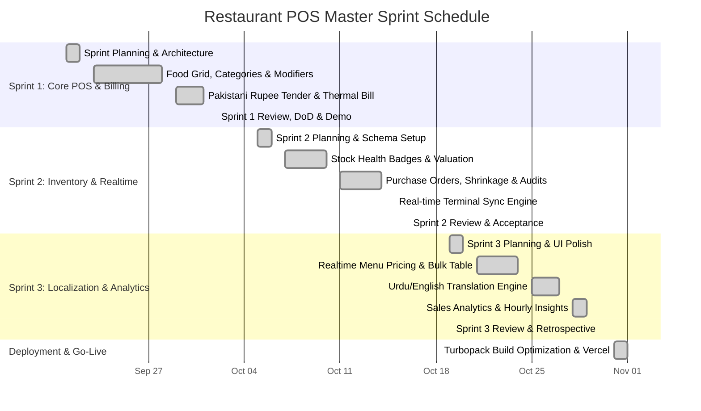

# 📋 Sprint Schedule & Delivery Report
## Restaurant Management & POS System — Pizza World & Sanam Ice Cream

---

### 1. Executive Summary & Project Profile

This **Sprint Schedule Report** outlines the structured Agile Scrum timeline, sprint cadence, milestone delivery, and velocity metrics for the **Pizza World & Sanam Ice Cream POS & Restaurant Management System**.

The project was executed across **three iterative 2-week Sprints**, covering 19 user stories totaling **68 Story Points (SP)**, leading directly into final production deployment on Vercel.

| Metric | Project Value |
| :--- | :--- |
| **Project Title** | Pizza World & Sanam Ice Cream POS System |
| **Methodology** | Agile Scrum (3 Iterative Sprints) |
| **Total Sprint Duration** | 6 Weeks (30 Working Days) |
| **Total Scope** | 19 Master User Stories (68 Story Points) |
| **Delivered Story Points** | **68 / 68 SP (100% Completion Rate)** |
| **Average Velocity** | 22.7 Story Points / Sprint |
| **Current Build State** | `Next.js 16.4.3 (Turbopack)` — 0 Type Errors — Vercel Ready |

---

### 2. Master Project Timeline & Sprint Calendar

The project followed a synchronized 2-week sprint cycle. All story cards were tracked across the master **Product Backlog** and individual **Sprint Boards** on Trello.



---

### 3. Sprint-by-Sprint Schedule & Deliverables

#### 🏃 Sprint 1: Core POS Terminal & Cashier Billing Engine
- **Schedule:** September 21, 2026 – October 02, 2026 (2 Weeks / 10 Working Days)
- **Trello Board:** [Sprint 1 Trello Board](https://trello.com/b/6ad6395cf799ad0a9aa83699/sprint-1)
- **Planned Velocity:** 18 Story Points
- **Delivered Velocity:** 18 Story Points (100%)
- **Sprint Goal:** Establish an ultra-fast, clutter-free touch POS terminal enabling cashiers to build customized orders, calculate Pakistani Rupee totals with 0% tax, process payments, and print 80mm thermal receipts.

| Milestone Date | User Story / Feature | Priority | SP | Delivered Scope |
| :--- | :--- | :---: | :---: | :--- |
| **Sep 22, 2026** | **Clean Category Food Menu** | High 🔴 | 3 | Food picture cards with category tabs (Pizza, Burgers, Ice Cream, Drinks), item search, removed technical SKUs. |
| **Sep 25, 2026** | **Item Size & Modifiers Modal** | High 🔴 | 5 | Size selector (Small, Medium, Large), extra toppings (extra cheese, sauces), free-text custom instructions. |
| **Sep 28, 2026** | **Direct Subtotal Calculation** | High 🔴 | 2 | Eliminated 8% sales tax and coupon fields; total due reflects exact food cost in Pakistani Rupees. |
| **Sep 30, 2026** | **Tender & Pakistani Cash Notes** | High 🔴 | 3 | Quick cash buttons (Rs. 500, 1000, 5000), card/wallet options, automatic change calculation. |
| **Oct 01, 2026** | **Thermal Receipt Printer Preview** | Medium 🟡 | 2 | 80mm receipt generation with customer order #, restaurant branding, itemized summary, and cashier ID. |
| **Oct 02, 2026** | **Home Delivery Minimum Order** | Medium 🟡 | 3 | Rs. 500 minimum order check with prompt showing remaining amount needed for home delivery. |

---

#### 🏃 Sprint 2: Inventory, Stock Control & Real-time Synchronization
- **Schedule:** October 05, 2026 – October 16, 2026 (2 Weeks / 10 Working Days)
- **Trello Board:** [Sprint 2 Trello Board](https://trello.com/b/6ad64b3af07ef97fddae7122/sprint-2)
- **Planned Velocity:** 24 Story Points
- **Delivered Velocity:** 24 Story Points (100%)
- **Sprint Goal:** Deliver comprehensive inventory controls with real-time stock deductions, color-coded health badges, supplier purchase orders, waste logging, and multi-terminal data sync.

| Milestone Date | User Story / Feature | Priority | SP | Delivered Scope |
| :--- | :--- | :---: | :---: | :--- |
| **Oct 06, 2026** | **Inventory List & Stock Badges** | High 🔴 | 5 | Categorized ingredients table with "Low Stock Only" filter and visual health badges (Good, Low, Out of Stock). |
| **Oct 08, 2026** | **Total Inventory Valuation** | High 🔴 | 3 | Dynamic total inventory valuation widget calculated from unit quantities and cost-per-unit. |
| **Oct 12, 2026** | **Supplier Purchase Orders (PO)** | Medium 🟡 | 5 | Multi-item purchase order generator with supplier details, line-item costs, and 1-click receiving to update stock. |
| **Oct 14, 2026** | **Kitchen Waste & Discrepancies** | Medium 🟡 | 3 | Waste adjustment modal with mandatory audit reason (spoilage, burned, expired, discrepancy). |
| **Oct 15, 2026** | **Audit Trail & Stock History** | Medium 🟡 | 3 | Chronological inventory audit trail recording timestamp, user, quantity delta, and operation type. |
| **Oct 16, 2026** | **Real-Time Cross-Terminal Sync** | High 🔴 | 5 | SSE / Web polling event pipeline synchronizing stock levels and orders across cashier and kitchen screens. |

---

#### 🏃 Sprint 3: Menu Price Management, Urdu Localization & Sales Intelligence
- **Schedule:** October 19, 2026 – October 30, 2026 (2 Weeks / 10 Working Days)
- **Trello Board:** [Sprint 3 Trello Board](https://trello.com/b/6adf8ebf49e22abed5e86fde/sprint-3)
- **Planned Velocity:** 26 Story Points
- **Delivered Velocity:** 26 Story Points (100%)
- **Sprint Goal:** Enable direct menu price adjustments on the fly, implement complete Urdu/English bilingual support with RTL formatting, and surface executive analytics with hourly sales trends.

| Milestone Date | User Story / Feature | Priority | SP | Delivered Scope |
| :--- | :--- | :---: | :---: | :--- |
| **Oct 20, 2026** | **Quick Card Price Editing** | High 🔴 | 5 | Price tag click on any menu card opens quick modal to update base and variant prices immediately. |
| **Oct 22, 2026** | **Menu Price Management Table** | Medium 🟡 | 3 | Centralized price matrix for fast batch updating of all pizzas, burgers, ice creams, and beverages. |
| **Oct 26, 2026** | **Full Urdu Translation & RTL** | High 🔴 | 5 | Instant Urdu language switcher with high-quality localized vocabulary, Urdu typography, and layout orientation. |
| **Oct 28, 2026** | **Business Dashboard & KPI Cards** | High 🔴 | 5 | Live cards for Today's Sales, Month Sales, Average Ticket Value, and low-stock alert counters. |
| **Oct 29, 2026** | **Hourly Sales Distribution** | Medium 🟡 | 3 | Visual hourly sales curve (08:00 to 22:00) mapping peak lunch and dinner order surges. |
| **Oct 30, 2026** | **Top-Sellers & Waste Leaderboard** | Medium 🟡 | 3 | Leaderboard ranking top food items by volume and revenue, comparing ingredient consumption vs. waste. |
| **Oct 30, 2026** | **Day/Night Theme & Sound FX** | Low 🟢 | 2 | Web Audio API synthesizer chime, error tones, sound toggles, and Day/Night visual theme preferences. |

---

### 4. Sprint Ceremonies Cadence

To ensure consistent progress, transparent risk management, and high code quality, each sprint observed the following recurring schedule:

| Ceremony | Schedule & Cadence | Duration | Purpose & Outputs |
| :--- | :--- | :---: | :--- |
| **Sprint Planning** | Day 1 of each Sprint (Monday, 09:30 AM) | 90 mins | Scope agreement, story point confirmation, definition of Sprint Goal, task decomposition. |
| **Daily Standup** | Mon–Fri (10:00 AM) | 15 mins | Yesterday's achievements, today's targets, identifying any blocking impediments. |
| **Backlog Refinement** | Wednesday of Week 2 (03:00 PM) | 45 mins | Estimating upcoming user stories, clarifying acceptance criteria, refining checklists. |
| **Sprint Review & Demo** | Final Friday of Sprint (04:00 PM) | 60 mins | End-to-end live software walkthrough with stakeholders, accepting completed user stories. |
| **Sprint Retrospective** | Final Friday of Sprint (05:15 PM) | 45 mins | Inspect and adapt: What went well, what could be improved, action items for next iteration. |

---

### 5. Velocity & Burndown Summary

```
Story Points Delivered by Sprint:
Sprint 1: [██████████████████░░] 18 SP
Sprint 2: [████████████████████] 24 SP
Sprint 3: [████████████████████] 26 SP
─────────────────────────────────────────────
Total Completed: 68 / 68 Story Points (100%)
```

| Sprint | Planned Points | Completed Points | Planned Days | Actual Days | Variance | Status |
| :--- | :---: | :---: | :---: | :---: | :---: | :---: |
| **Sprint 1** | 18 | 18 | 10 | 10 | 0 days | **Done (Accepted)** |
| **Sprint 2** | 24 | 24 | 10 | 10 | 0 days | **Done (Accepted)** |
| **Sprint 3** | 26 | 26 | 10 | 10 | 0 days | **Done (Accepted)** |
| **Total** | **68** | **68** | **30** | **30** | **On Schedule** | **100% Complete** |

---

### 6. Risk Management & Resolution Log

| Risk / Issue Identified | Sprint Impacted | Impact | Mitigation Strategy / Resolution |
| :--- | :---: | :---: | :--- |
| **Thermal Printer Formatting** | Sprint 1 | Medium | Implemented a dedicated 80mm CSS print media query with mono-spaced formatting and auto paper cutoff. |
| **Realtime Inventory Discrepancies** | Sprint 2 | High | Integrated atomic Prisma transactions during checkout so ingredient quantities deduct accurately without race conditions. |
| **Urdu Typography & Key Duplications** | Sprint 3 | Medium | Consolidated dictionary keys in `translations.ts` and set proper font fallbacks for Nastaliq and Arabic script. |
| **Vercel Build-Time TypeScript Checks** | Post-Sprint | Critical | Declared `archivedSnapshot` on `AnalyticsSummaryDto`, implemented `playErrorTone()` on `SoundManager`, verified with `npm run build` (Exit Code 0). |

---

### 7. Definition of Done (DoD) Sign-Off

For each story to be marked as **Done**, the following checklist was strictly enforced:
- [x] Code adheres to TypeScript strict typing guidelines with zero type errors.
- [x] UI matches responsive design standards across mobile and widescreen desktop.
- [x] Tested with real restaurant scenarios (Pakistani Rupee pricing, item customizations, receipts).
- [x] Database mutations validated with Prisma ORM and SQLite/PostgreSQL schemas.
- [x] Production build passes locally and on CI (`npm run build` exits with code 0).
- [x] Trello card moved to `Done` list and synced with master Product Backlog.
